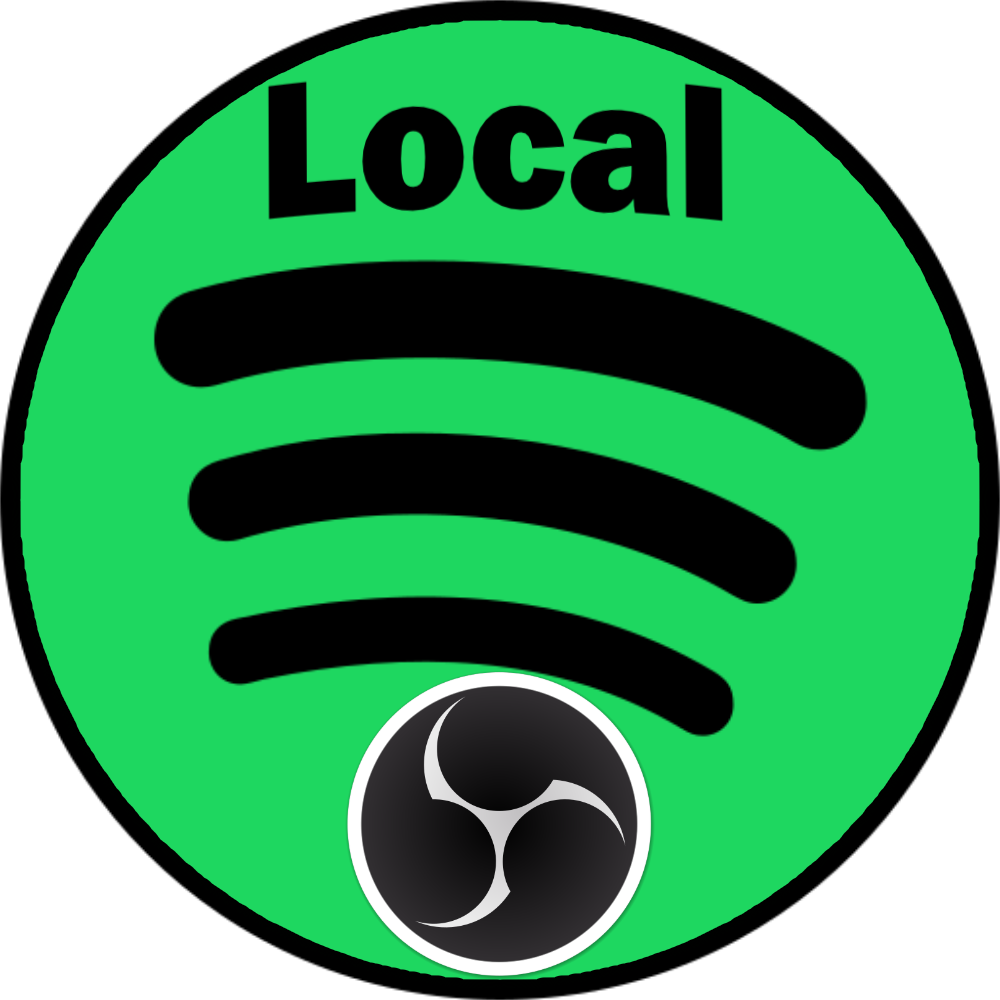
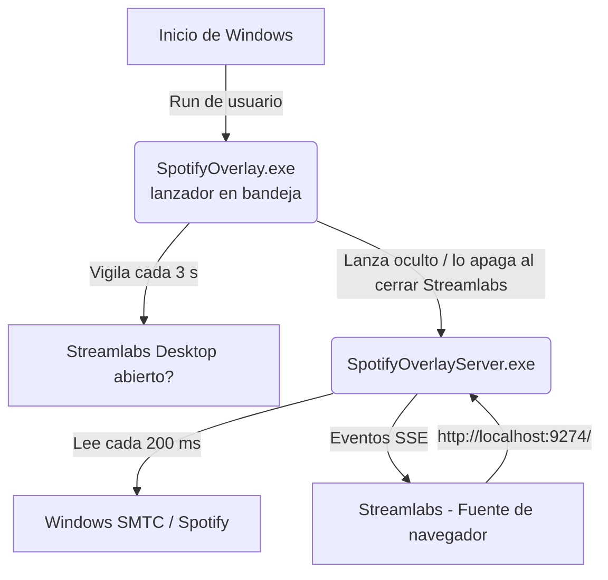

# 🎵 Spotify Local para Streamlabs (Widget)

<p align="center">
  
</p>

Widget **"Now Playing"** para **Streamlabs Desktop**: muestra la canción que suena en Spotify (o en cualquier app multimedia de Windows) con carátula, barra de progreso animada y **100 temas** a elegir. 100 % local: sin cuentas de Spotify, sin tokens y sin Internet.

> **Basado en el proyecto [Spotify-Local-For-OBS--Widget-](https://github.com/alvarro71/Spotify-Local-For-OBS--Widget-) de [alvarro71](https://github.com/alvarro71)**, adaptado y porteado a Streamlabs por **ElGonzaaTK** con la ayuda de Claude, con permiso del autor original. Todo el diseño del widget y sus 100 temas son obra del proyecto original.

---

## 🚀 Instalación

1. Descarga **`Instalar_Spotify_Local_Streamlabs.exe`** desde [Releases](../../releases) (o desde la pestaña *Actions* → último build → *Artifacts*).
2. Ejecútalo y pulsa **Instalar ahora**. No pide permisos de administrador y **no necesita tener OBS Studio instalado**.
3. En **Streamlabs Desktop**:
   1. En el panel **Fuentes**, pulsa **+** → **Fuente de navegador** (*Browser Source*).
   2. **URL:** `http://localhost:9274/`
   3. **Ancho:** `450` · **Alto:** `150`
4. Pon música en Spotify. El widget aparece solo al reproducir y se oculta al pausar.

### 🎨 Cambiar el tema

- Desde el propio instalador (si lo vuelves a abrir muestra el panel de temas con vista previa), **o**
- Clic derecho en el icono **♫** de la bandeja del sistema → **Cambiar aspecto del widget** (abre `http://localhost:9274/config` en el navegador).

El widget de Streamlabs se recarga solo al aplicar el tema.

### 🗑️ Desinstalar

Desde *Configuración de Windows → Aplicaciones instaladas → Spotify Local para Streamlabs*, o abriendo de nuevo el instalador y pulsando **Desinstalar**.

---

## ⚙️ ¿Qué cambia respecto a la versión de OBS?

En OBS el arranque automático lo hacía un plugin nativo (`obs-spotify-overlay.dll`). **Streamlabs no admite plugins `.dll` de terceros** (usa `obs-studio-node` internamente y sobrescribe su carpeta en cada actualización), así que el port sustituye esa pieza por un pequeño **lanzador de bandeja**:



| Pieza | Versión OBS (original) | Versión Streamlabs (este repo) |
|---|---|---|
| Instalación | Carpeta de plugins de OBS (requiere admin) | `%LOCALAPPDATA%\SpotifyLocalStreamlabs` (sin admin) |
| Auto‑arranque | Plugin `.dll` cargado por OBS | `SpotifyOverlay.exe` en la bandeja: modo **"Solo cuando Streamlabs está abierto"** (por defecto) o **"Siempre activo"** |
| Apagado | OBS mata el servidor al cerrarse | El lanzador lo apaga al cerrar Streamlabs; además el servidor se apaga solo si muere el lanzador (`--parent-pid`) |
| Cambiar tema | Reabrir el instalador | Instalador **o** página web `/config` desde la bandeja |
| Desinstalar | Instalador | Instalador **o** "Aplicaciones instaladas" de Windows |

El widget en sí (HTML/CSS/JS y los 100 temas) es el mismo, así que sigue funcionando también en OBS o en cualquier programa con fuente de navegador (activa el modo **"Siempre activo"** en la bandeja).

Otras mejoras pequeñas del servidor:
- `config.json` se guarda en la carpeta de instalación del usuario (antes intentaba escribir en `Program Files`).
- Cada widget conectado recibe su estado inicial (antes, una segunda fuente de navegador podía quedarse vacía hasta cambiar de canción).
- El respaldo por título de ventana de Spotify (`tasklist`) solo se ejecuta cuando hay algún widget conectado.
- Si el puerto 9274 ya está ocupado (por ejemplo, tienes también la versión de OBS instalada), no se lanza un segundo servidor: el widget usa el que ya existe.

---

## 🛠️ Estructura del proyecto

```text
├── server/        Servidor Node.js (Express + SMTC) con el widget y los 100 temas
│   ├── server.js
│   └── themes.js  Nombres de los temas (para /config)
├── launcher/      Lanzador de bandeja SpotifyOverlay.exe (C#, .NET Framework 4.8, ~90 KB)
├── installer/     Instalador gráfico con vista previa de temas (C#, .NET 9, WebView2)
├── shared/        Código C# común (rutas, registro de Windows, detección de Streamlabs)
├── build.ps1      Compila todo y genera dist\Instalar_Spotify_Local_Streamlabs.exe
└── .github/workflows/build.yml   Compila en Windows en cada push y publica Releases en tags v*
```

### Compilar

En Windows con **Node.js 22** y **.NET SDK 9**:

```powershell
powershell -ExecutionPolicy Bypass -File build.ps1
```

O simplemente haz push: GitHub Actions genera el instalador como artefacto. Para publicar una Release, crea un tag `v1.0.0`.

Para desarrollar el servidor sin compilar nada: `cd server && npm install && npm start` y abre `http://localhost:9274/config`.

---

## ❤️ Créditos

- **Idea, diseño, arquitectura y los 100 temas del widget:** [alvarro71](https://github.com/alvarro71) — proyecto original [Spotify-Local-For-OBS--Widget-](https://github.com/alvarro71/Spotify-Local-For-OBS--Widget-) (MIT).
- **Port a Streamlabs:** ElGonzaaTK, con la ayuda de Claude (Anthropic).

Licencia MIT — ver [LICENSE](LICENSE).
